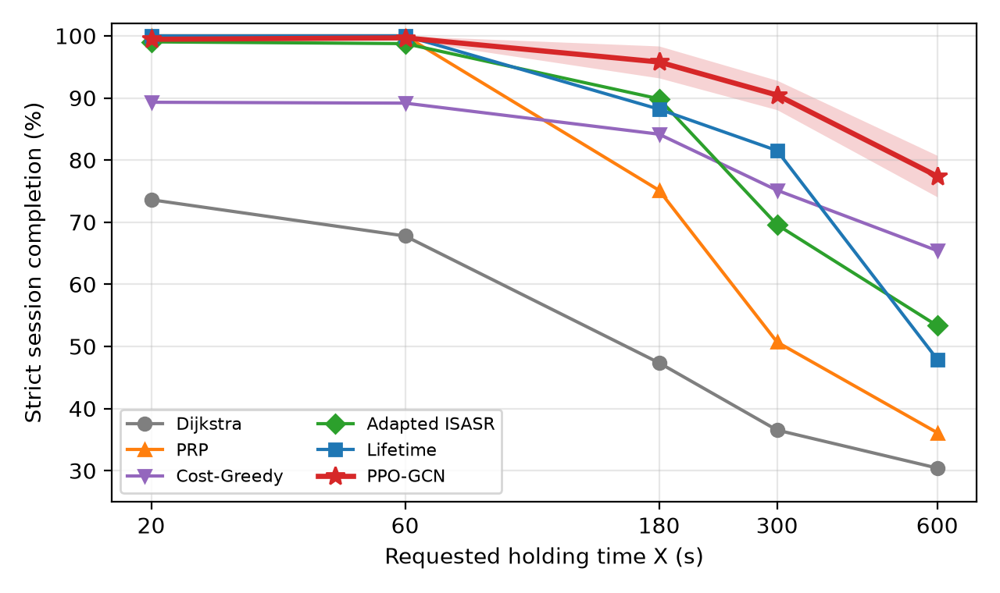
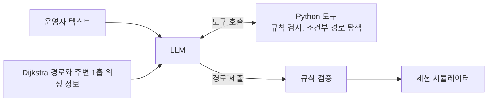
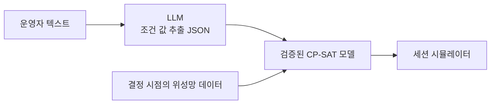

# 시변 저궤도 위성망의 세션 경로 최적화: 그래프 강화학습, 수리최적화, LLM

저궤도(LEO) 위성망에서 지상국 사이의 통신 세션을 끝까지 유지하는 경로 최적화 프로젝트. 자원 용량(터미널 수), 셋업 시간
(PAT), 가용 시간창(링크 수명)이 있는 **조합최적화와 순차 의사결정 문제**를 강화학습으로 풀고, 운영 중 바뀌는 조건은
LLM이 해석해 검증된 도구와 수리최적화 solver로 반영.

- **문제**: 위성이 계속 움직여 위성 간 광 링크(ISL)가 생기고 끊어지는 **시변 그래프**. 새 링크 설정에는 광 터미널을
  상대 위성에 맞추는 PAT(Pointing, Acquisition, Tracking) 시간이 들고, 위성마다 터미널 수도 제한. 지금 연결된 최단
  경로도 세션 도중 끊길 위험
- **접근**: 세션이 끝까지 유지되는 경로를 고르는 그래프 강화학습 정책을 먼저 개발. 실제 운영에서는 위성 정비, 규제
  지역, 지연 요구 같은 조건이 수시로 바뀌고 텍스트로 전달되므로, 조건마다 재학습하는 대신 LLM이 조건을 해석하고
  검증된 경로 도구와 수리최적화 모델이 경로를 계산하도록 확장
- **평가**: 세 방법 모두 같은 시뮬레이터와 같은 고정 테스트셋(3,600개와 그 부분집합)에서 평가, 각자의 목표에서 기존
  방법보다 높은 성능 확인

## 핵심 결과

| 질문 | 방법 | 결과 |
|---|---|---|
| 링크 수명과 PAT 지연을 고려해 세션을 끝까지 유지할 수 있는가 | PPO-GCN (그래프 강화학습, WCNC 2027 투고 논문) | 세션 완주율 **92.56%**. 가장 강한 기준 방법(Lifetime 83.53%)보다 9.0%p 높고, 600초 세션(77.41%)에서 차이 최대 |
| 운영자의 텍스트 조건을 경로에 반영할 수 있는가 | LLM 에이전트와 Python 도구 (학습 없이 추론만) | 조건 5종 모두에서 준수가 크게 개선. 위성 정비 공지 조건에서 완주율 **86.7%** (PPO-GCN 77.0%) |
| 여러 조건을 동시에 지킬 수 있는가 | LLM이 검증된 CP-SAT 모델의 조건 값을 채움 | GPT-4o **20/20**, GPT-4o mini 19/20이 모든 조건 준수. 금지 지역 위반 0%, 요청당 비용 약 0.001달러 |

이 저장소에서 다룬 것:

- **수리최적화 정식화**: 다중 자원 제약 경로 문제(흐름 보존, 자원 상한, 시간창, 지연 상한, 셋업 횟수 상한)를 CP-SAT
  정수계획으로 정식화하고, 정답 기준 모델로 다른 방법의 최적성과 제약 준수를 채점
- **순차 의사결정과 강화학습**: 경로 설정을 MDP로 정식화하고 그래프 신경망 정책을 PPO로 학습. 실행할 수 없는 행동은
  행동 마스킹으로 제거
- **LLM 기반 optimization agent**: LLM의 reasoning과 tool use로 운영자의 자연어 조건을 solver 인자와 최적화 모델의
  조건 값으로 변환하고, solver와 simulator로 결과를 검증
- **OR, ML, RL 결합**: 휴리스틱 기준 방법, 강화학습 정책, 정수계획 solver, LLM 에이전트를 같은 simulator와 같은
  테스트셋에서 비교하고 결합
- **엄밀한 평가**: event-driven simulator, 고정 테스트셋, 개발용과 평가용 요청 분리, 신뢰구간과 McNemar 검정,
  논문 수치 재현 검증, LLM이 쓴 코드의 격리 실행

## 연구 흐름

| 단계 | 문제 | 방법 | 성과 |
|---|---|---|---|
| 1 | 패킷을 한 홉씩 전달하는 모델에서 링크의 남은 접촉 시간을 반영한 선제적 라우팅 | GCN-PPO | 석사 학위논문, 한국항공우주학회 학술대회 구두발표 (2026.06) |
| 2 | 세션 단위 모델. 터미널 수와 PAT 설정 지연을 반영한 세션 경로 설정과 유지 | PPO-GCN, 기준 방법 5종 | WCNC 2027 투고, 공동 제1저자 (심사 중) |
| 3 | 2단계 환경에서 운영자의 텍스트 조건을 지키는 경로 | LLM 에이전트, Python 도구, CP-SAT | 같은 테스트 요청에서 조건 5종 준수 개선, 여러 조건 20/20 준수 |

---

## 1. 문제: 세션이 끝날 때까지 유지되는 경로

- **요청**: 출발 지상국, 도착 지상국, 도착 시각 $t_0$, 유지 시간 $X$
- **목표**: $t_0$에 지상국 간 ISL 경로를 세우고 $X$초 동안 끊김 없이 유지
- **남은 접촉 시간** $T_{\mathrm{rem}}(i,j,t)$: 링크 $(i,j)$가 시각 $t$부터 더 유지되는 시간
- **어려운 점**: 300초 세션에서 Dijkstra는 남은 접촉 시간이 27.1초뿐인 지름길 링크를 골라 도중에 끊기지만, 수명이 긴
  링크(207.3초)로 만든 경로는 끝까지 유지(논문 그림 1). 반대로 수명만 따지면 경로가 길어지고 새 링크 설정이 늘어나므로
  링크 수명, 경로 길이, PAT 설정 비용 사이의 균형이 핵심

| 항목 | 설정 |
|---|---|
| 궤도 | Walker-Delta 1584/24/11 (위성 1,584개), 고도 550 km, 경사각 53° |
| 링크 거리 | 위성 간 1,500 km, 지상과 위성 사이 1,000 km |
| 터미널 | 위성마다 같은 궤도면 이웃과 잇는 고정 터미널 2개, 다른 궤도면 위성과 잇는 재구성 터미널 1개 |
| PAT | 새 위성 간 링크 설정에 20초. 한 경로의 새 링크는 동시에 설정 |
| 세션 | 뉴욕에서 런던, 이스탄불, 하노이로 가는 지상 쌍 3개, 유지 시간 $X$ = 20, 60, 180, 300, 600초 |
| 재경로 | 경로에서 가장 먼저 끝나는 링크보다 PAT 시간만큼 앞서 새 경로 설정 |
| 테스트 요청 | 지상 쌍 3 × 유지 시간 5 × 궤도 주기(5,739초)에 고르게 놓은 도착 시각 240 = **3,600개**, 고정 |
| 핵심 지표 | **세션 완주율**: 경로를 세운 뒤 $X$초 동안 한 번도 끊기지 않은 세션의 비율 |
| 보조 지표 | 설정 성공률, 가용도, 끊긴 시간, 재구성 수, 새 링크 수, 경로 길이 |

## 2. PPO-GCN: 그래프 강화학습으로 경로 만들기 (WCNC 2027 투고 논문)

> Contact-Time-Aware Session Establishment in Dynamic LEO Satellite Networks via Graph Reinforcement Learning

**핵심 설계**: 경로 전체를 한 번에 최적화하는 대신, 현재 위성망 그래프에서 **다음 중계 위성을 하나씩 고르는 순차 결정**(MDP)으로 경로 구성

| 구성 | 내용 |
|---|---|
| 상태 | 실행 가능한 링크의 인접 행렬, 위성 특징(위치, 도착 위성과의 관계, 경로에서의 역할, 재구성 터미널 사용 여부, 남은 서비스 시간), 링크 특징(거리, 남은 접촉 시간, 활성 여부, 현재 경로 재사용 여부) |
| 행동 | 다음 중계 위성. 이미 지난 위성, 재구성 터미널을 두 번 쓰는 링크, 설정이 끝나기 전에 끊기는 새 링크는 마스킹 |
| 정책 | 3층 GCN 인코더와 actor-critic. 후보 위성의 임베딩을 현재 위성, 도착 위성과 비교해 점수 계산 |
| 보상 | 중계 단계별 점수, 경로 설정 성공과 유지 시간, 세션 완주에 대한 최종 보상, 설정 실패와 끊김에 대한 벌점 |
| 학습 | PPO, 시드 3개, 시드당 100만 단계, 학습률 3e-3, 할인율 0.99, GAE 0.95, 클리핑 0.2 |
| 기준 방법 | Dijkstra(최소 홉), Lifetime(링크 수명 우선), PRP, Adapted ISASR, Cost-Greedy(같은 점수를 한 단계씩 탐욕적으로 최대화) |

### 결과 (테스트 3,600개, 논문 표 II)

| 방법 | 설정 성공 (%) | **완주 (%)** | 가용도 (%) | 끊긴 시간 (s) | 재구성 | 새 링크 | 경로 (km) |
|---|---:|---:|---:|---:|---:|---:|---:|
| Dijkstra | 86.11 | 51.14 | 74.19 | 34.93 | 1.069 | 12.39 | 14,006 |
| PRP | 100.00 | 72.39 | 93.30 | 31.33 | 0.971 | 11.26 | 14,764 |
| Cost-Greedy | 89.00 | 80.64 | 86.23 | 13.47 | 0.656 | 0.56 | 25,832 |
| Adapted ISASR | 99.44 | 82.11 | 98.01 | 5.68 | 1.085 | 4.59 | 14,586 |
| Lifetime | 100.00 | 83.53 | 98.97 | 4.32 | 0.924 | 9.42 | 14,885 |
| **PPO-GCN** (시드 3개 평균) | 99.45 | **92.56** | 98.64 | **3.67** | 0.912 | 12.15 | 18,436 |



- **긴 세션일수록 차이 확대**: 600초 세션 완주율 PPO-GCN 77.41%, Cost-Greedy 65.42%, Adapted ISASR 53.33%,
  Lifetime 47.92% (그림의 띠는 시드 3개의 표준편차)
- **설정 성공과 완주의 차이**: Lifetime과 PRP는 설정 성공률 100%지만 완주율은 83.53%, 72.39%. 지금 연결되는지보다
  끝까지 유지되는지가 중요하다는 근거
- **불가능한 요청과 구분**: 같은 터미널과 PAT 가정에서 모든 요청을 완주하는 경로의 존재를 확인(feasibility witness)해,
  정책의 실패와 물리적으로 불가능한 요청을 구분

**요소 제거 실험 (시드 0, 논문 표 III)**

| 모델 | 완주 (%) | 600초 세션 완주 (%) |
|---|---:|---:|
| PPO-GCN 전체 | 94.44 | 80.83 |
| 남은 접촉 시간 특징 제거 | 78.22 | 40.28 |
| PAT 설정 비용 항 제거 (설정 지연 20초는 그대로) | 83.64 | 54.58 |

**추가 분석: PAT 설정 지연 민감도** (기준 방법, 유지 시간 180초와 300초 요청 360개)

| PAT 설정 지연 | Dijkstra | PRP | Adapted ISASR | Lifetime |
|---:|---:|---:|---:|---:|
| 0초 | 100% | 100% | 100% | 100% |
| 5초 | 53.1% | 75.3% | 70.0% | 91.1% |
| 20초 | 42.2% | 65.8% | 80.0% | 86.4% |

설정 지연이 없으면 모든 기준 방법이 100% 완주. 이 문제를 어렵게 만드는 핵심 요인은 PAT 설정 지연.

---

## 3. 운영 조건 반영: LLM 에이전트

- **배경**: PPO-GCN은 학습한 목표(세션 완주)에는 강하지만 운영 중 새로 생기는 조건은 반영 불가. 위성 운영에서는
  "위성 1181은 1218초부터 정비로 중단", "북대서양 상공은 규제로 통과 금지" 같은 조건이 수시로 바뀌고 텍스트로 전달
- **설계**: 조건마다 보상을 바꿔 재학습하는 대신, **조건 해석은 LLM이, 경로 계산과 규칙 검증은 검증된 Python 도구가 담당**
- **평가**: 학습 없이 추론만. 고정 테스트셋에서 뽑은 180개 요청으로 평가하고, 기준 방법과 PPO-GCN도 **같은 180개 요청과
  같은 조건**에서 다시 실행해 비교



- **입력**: Dijkstra 경로, 그 경로에서 1홉 이내 위성과 링크 정보(종류, 남은 접촉 시간, 길이), 운영자 텍스트. 위성 1,584개
  전체 대신 Dijkstra 경로 주변으로 입력을 줄이고, 필요하면 도구로 망 전체를 탐색
- **출력**: 지상국 사이의 경로 전체를 한 번에 수정. 결정 시점은 PPO-GCN과 동일(세션 시작과 재경로)
- **도구**: `check_route`(규칙 검사), `find_route`(피할 위성과 지역, 링크 최소 수명, 목표를 지정한 경로 탐색),
  `submit_route`(제출, 규칙을 어기면 거절). 도구는 텍스트를 읽지 않으므로 텍스트를 도구 인자로 바꾸는 일은 LLM 담당
- **실패 처리**: 규칙을 어긴 답, 형식 오류, API 오류는 Dijkstra 경로로 대신 실행하고 무효로 집계

### 실험 설정

| 항목 | 설정 |
|---|---|
| 평가 요청 | 고정 테스트 3,600개 중 지상 쌍 3 × 유지 시간 5 × 도착 시각 12 = 180개 |
| 모델 | GPT-4o, GPT-4o mini (OpenAI API, temperature 0, seed 0) |
| 개발과 평가 분리 | 프롬프트와 도구는 평가 요청과 겹치지 않는 개발용 요청에서만 고치고, 평가는 확정 뒤 한 번 실행 |
| 조건 준수 측정 | 세션 동안 실제로 쓴 경로를 10초 간격으로 따라가며 측정 |
| 재현 확인 | 조건이 없을 때 기준 방법과 PPO-GCN 결과가 논문 결과와 값 하나까지 일치 |

| 운영 조건 | 텍스트 예 (실제 시나리오) | 측정 |
|---|---|---|
| 위성 정비 | "정비 공지: 위성 1181, 시각 1218초부터 서비스 중단." | 시뮬레이터에서 실제로 위성이 꺼짐(다른 방법은 미리 모름). 완주율 |
| 혼잡 지역 | "북대서양 구간 부하가 높아. 되도록 덜 거치게 해 줘." | 중계 위성이 그 지역 위에 있던 시간 |
| 통과 금지 지역 | "보안 정책: 북대서양 상공 통과 금지." | 중계 위성이 그 지역 위에 있던 시간 |
| PAT 재지향 상한 | "운용 지침: 이 세션의 새 링크 설정은 최대 1회." | 세션 전체 새 링크 수가 상한을 넘은 세션 |
| 지연 상한 | "QoS 조건: 단방향 지연 30 ms 이하." | 지연이 상한을 넘은 시간 |

### 결과 (180개, LLM = GPT-4o mini)

| 운영 조건 | 지표 | Dijkstra | PPO-GCN | LLM, 도구 없음 | LLM + 도구 |
|---|---|---:|---:|---:|---:|
| 없음 | 완주율 (높을수록 좋음) | 59.4% | 93.0% | 58.9% | 78.9% |
| 위성 정비 | 완주율 (높을수록 좋음) | 4.4% | 77.0% | 2.8% | **86.7%** |
| 혼잡 지역 | 그 지역 위에 있던 시간 (낮을수록 좋음) | 91.7% | 94.2% | 91.8% | **17.9%** |
| 통과 금지 지역 | 그 지역 위에 있던 시간 (낮을수록 좋음) | 90.6% | 95.7% | 91.3% | **41.4%** |
| PAT 재지향 상한 | 상한을 넘은 세션 (낮을수록 좋음) | 100% | 99.4% | 99.4% | **22.8%** (완주 96.7%) |
| 지연 상한 | 상한을 넘은 시간 (낮을수록 좋음) | 18.2% | 52.3% | 21.6% | **12.5%** (완주 83.9%) |

- **위성 정비**: 정비 위성은 Dijkstra 경로에서 선택. PPO-GCN은 경로가 Dijkstra와 달라 86%의 세션에서 우연히 그 위성을
  피했고, 첫 경로가 그 위성을 지난 세션의 완주율은 1.8%. LLM과 도구는 공지를 읽고 100% 회피(GPT-4o와 도구는 완주율 72.8%)
- **도구의 효과**: 규칙을 지킨 답의 비율이 도구 없이 24~74%, 도구를 쓰면 58~100%
- **조건이 없을 때**: 완주만 목표로 학습한 PPO-GCN이 가장 높고, LLM과 도구도 Dijkstra 대비 +19.5%p. GPT-4o는 도구
  없이도 67.8%로 Dijkstra보다 유의하게 우세(McNemar p = 0.004)

---

## 4. 여러 조건을 동시에: LLM과 검증된 CP-SAT 모델

- **배경**: 여러 조건이 겹치면 경로 찾기는 **자원 제약이 여러 개인 최단 경로 문제**(일반적으로 NP-hard). 조건을 하나씩
  다루는 경로 탐색 도구로는 전부 보장하기 어려운 구조
- **설계**: 앞 절의 역할 분담을 이어, **LLM은 텍스트에서 조건 값만 추출하고 경로 최적화는 CP-SAT 정수계획 모델이 담당**



**CP-SAT 정식화**: 사용할 수 있는 링크의 방향 호 $(u,v)$마다 경로 포함 여부 $x_{uv} \in \{0,1\}$, 접속 위성 $s$,
도착 위성 $d$

$$
\begin{aligned}
\min \quad & \textstyle\sum_{(u,v)} x_{uv} && \text{(최소 홉)} \\
\text{s.t.} \quad & \textstyle\sum_{v} x_{uv} - \sum_{v} x_{vu} = \mathbf{1}[u=s] - \mathbf{1}[u=d] \quad \forall u && \text{(흐름 보존)} \\
& \textstyle\sum_{v} x_{uv} \le 1, \ \sum_{v} x_{vu} \le 1 \quad \forall u && \text{(분기 없음)} \\
& \textstyle\sum_{(a,b) \in \mathcal{I}(u)} x_{ab} \le 1 \quad \forall u && \text{(위성마다 궤도면 간 링크 1개)} \\
& x_{uv} = 0 \ \text{ if } T_{\mathrm{rem}}(u,v) < X + T_{\mathrm{setup}} \mathbf{1}[(u,v) \text{ 새 링크}] && \text{(링크 수명)} \\
& x_{uv} = 0 \ \text{ if } u \in \mathcal{R} \text{ or } v \in \mathcal{R} && \text{(금지 지역 위성)} \\
& \big(\ell_{\mathrm{ground}} + \textstyle\sum_{(u,v)} \ell_{uv} x_{uv}\big) / c \le D_{\max} && \text{(지연 상한)} \\
& \textstyle\sum_{(u,v) \text{ 새 링크}} x_{uv} \le K - K_{\mathrm{used}} && \text{(PAT 재지향 상한)}
\end{aligned}
$$

- **기호**: $\mathcal{I}(u)$ 위성 $u$에 닿는 궤도면 간 호, $\ell_{uv}$ 링크 길이, $\ell_{\mathrm{ground}}$ 두 지상 링크 길이,
  $c$ 광속, $K_{\mathrm{used}}$ 이 세션에서 이미 켠 새 링크 수. 재경로할 때도 그 시점의 데이터로 같은 모델 사용
- **LLM의 역할**: 텍스트를 읽어 조건 값(금지 지역 $\mathcal{R}$, 지연 상한 $D_{\max}$, 새 링크 상한 $K$, 링크 수명 요구)만
  JSON으로 출력
- **solver의 역할**: 최적성과 규칙 준수 보장. LLM이 틀릴 수 있는 부분을 조건 읽기 하나로 축소

### 결과 (20개)

모든 요청에 "세션이 끝날 때까지 끊기지 않는 링크만" 조건과 통과 금지 지역, 지연 상한, 새 링크 상한 중 2~3개를 함께
부여(조합 4종 × 5개). 예: "세션이 끝날 때까지 끊기지 않는 링크만 써 줘. 북미 동부 상공은 규제 때문에 통과 금지야.
단방향 지연은 45 ms 이하여야 해. PAT 재지향(새 링크 설정)은 이 세션에서 8번까지만."

| 방법 | 요청 시각에 조건 모두 준수 | 세션 중 금지 지역 위반 | 완주율 |
|---|---:|---:|---:|
| 기준 방법 5종, PPO-GCN | 0~5% | 100% | 65~98% |
| LLM 경로 수정과 도구 (GPT-4o mini) | 15% | 60% | 80% |
| **LLM이 검증된 CP-SAT 모델의 조건을 채움 (GPT-4o)** | **100%** | **0%** | **85%** |
| LLM이 검증된 CP-SAT 모델의 조건을 채움 (GPT-4o mini) | 95% | 0% | 85% |

- **조건 추출 정확도**: 두 모델 모두 20개 요청의 조건 값을 전부 정확히 추출. mini의 남은 1개는 CP-SAT가 20초 안에 해를
  찾지 못한 경우
- **완주율**: 조건을 지키느라 경로가 길어져 PPO-GCN(98%)보다 낮지만, PPO-GCN은 조건을 모두 지킨 요청이 0개
- **설계 선택**: LLM이 CP-SAT 코드를 처음부터 작성하는 방식도 시험했지만 실행 검사를 통과하지 못해, 검증된 모델에 조건
  값을 채우는 구조를 채택(격리 실행 환경 `llm_routing/sandbox.py`, 결과 `results_llm/table_multi.md`)
- **비용**: 요청당 LLM 비용 약 0.001달러

## 정리

운영 조건이 계속 바뀌는 순차 의사결정 문제를 수리최적화와 강화학습으로 정식화해 풀고, LLM이 reasoning과 tool use로
solver와 simulator를 움직이는 optimization agent까지 구현해 같은 테스트셋에서 검증.

### 같은 구조의 산업 최적화 문제

위성 경로 문제의 각 요소가 생산계획, 스케줄링, 자원배분 문제의 요소와 대응해, 같은 정식화와 방법을 적용할 수 있는 구조.

| 이 프로젝트 | 산업 최적화 문제 |
|---|---|
| 위성마다 재구성 터미널 1개 | 설비와 자원의 용량 제약 |
| 새 링크 설정의 PAT 시간 20초 | 작업 전환 시 셋업 시간 |
| 링크의 남은 접촉 시간 | 설비와 자원의 가용 시간창 |
| 세션 유지 시간, 지연 상한 | 작업 기간, 납기와 리드타임 |
| 위성 정비 공지 | 설비 예방보전으로 인한 가용 자원 변화 |
| PAT 재지향 상한 | 셋업과 교체 횟수 제한 |
| 링크가 끊기기 전 선제 재경로 | 상황 변화에 따른 재계획(rescheduling) |
| 운영자의 텍스트 조건 | 현장에서 자연어로 오는 운영 요구와 변경 사항 |

---

## 저장소 구성

| 경로 | 내용 |
|---|---|
| **`leo_session/`** | **위성망과 세션 시뮬레이터** |
| `orbit.py`, `contacts.py`, `ground.py` | Walker-Delta 궤도, 위성 간 접촉 구간, 지상국과 위성의 접속 구간 |
| `topology.py` | 세션이 도착하기 전의 활성 링크 구성 |
| `routing.py` | 기준 경로 방법 5종(Dijkstra, Lifetime, PRP, Adapted ISASR, Cost-Greedy) |
| `environment.py` | 이벤트 기반 세션 시뮬레이터: 경로 설정, PAT 지연, 선제 재경로, 위성 정비 반영 |
| `reward.py`, `config.py` | PPO-GCN 보상, 모든 수치 설정과 출처 |
| **`ppo_gcn/`** | **PPO-GCN** |
| `observation.py`, `model.py`, `trainer.py` | 희소 그래프 관측, GCN actor-critic과 PPO 업데이트, 궤적 수집과 학습과 평가 |
| **`llm_routing/`** | **LLM 에이전트와 CP-SAT** |
| `route_edit.py`, `planner.py` | LLM 입력 구성(Dijkstra 경로와 주변 위성), 경로 규칙 검증, LLM 경로 수정 방식 |
| `tools.py` | 에이전트 도구(`check_route`, `find_route`, `submit_route`) |
| `compliance.py` | 세션 동안의 조건 준수 측정 |
| `formulation.py`, `sandbox.py` | CP-SAT 정식화와 채점기, LLM이 쓴 코드의 격리 실행 |
| `regions.py`, `llm.py` | 지역 범위와 위성 위도, 경도 계산, 모든 모델 공통의 OpenAI 호환 API 호출 |
| **`scripts/`** | **실행 스크립트** |
| `train_gcn_ppo.py`, `evaluate_gcn_ppo.py` | PPO-GCN 학습과 고정 테스트셋 평가 |
| `run_cpu_baselines.py`, `build_contact_trace.py` | 기준 방법 실행, 접촉 구간 캐시 생성 |
| `make_scenarios.py` | 조건 시나리오(위성 정비, 혼잡 지역, 금지 지역, PAT 상한, 지연 상한, 여러 조건) 생성 |
| `run_llm_routing.py`, `run_constraint_baselines.py` | LLM 에이전트 실행, 같은 조건에서 기준 방법과 PPO-GCN 실행 |
| `run_formulation.py` | 여러 조건 실험(CP-SAT 기준 모델, LLM 코드 작성, LLM 조건 채우기) |
| `make_llm_table.py`, `make_multi_table.py` | 논문 표 II 형식 결과표, 여러 조건 결과표 |
| `plot_completion_by_holding_time.py` | 유지 시간별 완주율 그림 |
| `verify_reproduction_bundle.py` | 입력, 체크포인트, 핵심 결과의 재현 검증 |
| **`tests/`** | 보상, 세션 시뮬레이터, PPO-GCN 경로 보상, LLM 경로 검증, CP-SAT 모델, 격리 실행 테스트 |
| **`results_paper/`** | 기준 방법의 테스트 3,600개 결과, PAT 설정 지연 민감도, feasibility witness |
| **`results_ppo_gcn/`** | PPO-GCN 체크포인트(시드 3개, 요소 제거 2개, 5층 비교 모델)와 평가 결과, 통계 검정 |
| **`results_llm/`** | 조건 시나리오, 방법별 실행 기록, 결과표 ([폴더 안내](results_llm/README.md)) |
| **`docs/`** | 설계, 보상, 평가 지표, 실험 절차, 참고문헌, 재현 방법, LLM 실험 규약 |
| **`cache/`** | 위성 간 접촉 구간 캐시 |

## 재현

```bash
python3.12 -m venv .venv
.venv/bin/python -m pip install -r requirements.txt

.venv/bin/python -m pytest -q tests                            # 테스트
.venv/bin/python scripts/verify_reproduction_bundle.py         # 입력, 체크포인트, 핵심 결과 검증
.venv/bin/python scripts/make_llm_table.py --check-paper       # 논문 표 II 재계산
.venv/bin/python scripts/plot_completion_by_holding_time.py    # 유지 시간별 완주율 그림
.venv/bin/python scripts/make_multi_table.py                   # 여러 조건 실험 결과표
```

LLM 실험 실행에는 `.env`의 `OPENAI_API_KEY` 필요.

## 문서

| 문서 | 내용 |
|---|---|
| [`docs/TECHNICAL_OVERVIEW_KO.md`](docs/TECHNICAL_OVERVIEW_KO.md) | 시뮬레이터와 PPO-GCN 전체 기술 정리 |
| [`docs/DESIGN.md`](docs/DESIGN.md), [`docs/IMPLEMENTATION_KO.md`](docs/IMPLEMENTATION_KO.md) | 세션 모델 설계와 구현 설명 |
| [`docs/GCN_PPO.md`](docs/GCN_PPO.md), [`docs/REWARD_DESIGN.md`](docs/REWARD_DESIGN.md) | PPO-GCN 구조와 보상 설계 |
| [`docs/COST_GREEDY.md`](docs/COST_GREEDY.md) | Cost-Greedy 기준 방법 정의 |
| [`docs/EVALUATION_METRICS.md`](docs/EVALUATION_METRICS.md) | 평가 지표 정의 |
| [`docs/EXPERIMENT_PROTOCOL.md`](docs/EXPERIMENT_PROTOCOL.md), [`docs/FROZEN_TEST_EVALUATION_POLICY_KO.md`](docs/FROZEN_TEST_EVALUATION_POLICY_KO.md) | 기준 방법 실험 절차, 고정 테스트셋 평가 원칙 |
| [`docs/REFERENCES.md`](docs/REFERENCES.md) | 수치 설정과 알고리즘의 참고문헌 |
| [`docs/REPRODUCE.md`](docs/REPRODUCE.md) | 테스트 3,600개 재현과 PPO-GCN 학습 명령 |
| [`docs/CHECKPOINT_INDEX.csv`](docs/CHECKPOINT_INDEX.csv), [`docs/ENVIRONMENT_SNAPSHOT.json`](docs/ENVIRONMENT_SNAPSHOT.json) | 체크포인트 목록과 해시, 실행 환경 기록 |
| [`results_ppo_gcn/priority_evidence_2026-09-04/RESULTS.md`](results_ppo_gcn/priority_evidence_2026-09-04/RESULTS.md) | PPO-GCN 전체 결과와 통계 검정 |
| [`docs/LLM_ROUTING.md`](docs/LLM_ROUTING.md) | LLM 실험 규약, 조건별 시나리오와 지표, 개발 기록 |
| [`results_llm/README.md`](results_llm/README.md) | LLM 실험 결과표와 실행 기록 안내 |
